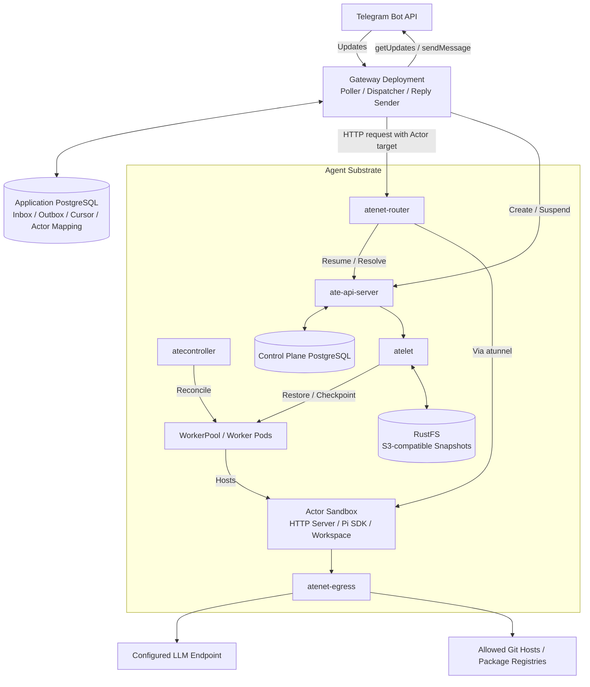

# Telegram Pi Actor Architecture

Status: Design baseline. The application, charts, and cluster have not been implemented or validated.

## Confirmed decisions

| Area | Decision |
|---|---|
| Local environment | kind, with the Substrate gVisor backend; verify host compatibility before installation |
| Deployment target | Kubernetes, Helm, and Argo CD |
| Telegram transport | Long polling; no public webhook, tunnel, or application Ingress |
| Isolation | One Actor per Telegram chat or topic |
| Agent | Earendil Pi SDK, with model requests handled by `pi-ai` |
| Tools | `read`, `write`, `edit`, and `bash` inside the Actor sandbox |
| Authorization | An allowlist of numeric Telegram User IDs |
| Private chat trigger | Messages from an authorized user |
| Group and topic trigger | An authorized user's message that mentions this Bot or replies to this Bot |
| LLM connection | OpenAI provider with `OPENAI_BASE_URL` and `OPENAI_API_KEY`; no `AZURE_` variables |
| LLM endpoint | `https://national-team.openai.azure.com/openai/v1` |
| Development network | Explicitly allowed Git hosts and package registries, in addition to the LLM endpoint |

Actual User IDs, model and deployment details, development hostnames, and secret values are deployment inputs. They do not require a different architecture.

## Components



An Actor is a stateful workload, not a Kubernetes Pod. Suspended Actors release worker capacity. A later request can restore an Actor onto a suitable worker.

The Gateway starts as one application with three responsibilities: polling, dispatch, and reply delivery. It does not need a separate message broker or Actor Manager service for the first version. Start with one Gateway replica and two workers.

Application and Substrate data can share a PostgreSQL instance for local validation. Use separate databases and roles. The application must not read or change Substrate's internal tables.

## Authorization and conversation routing

Apply authorization and trigger checks before adding work to the inbox or creating an Actor. Use the current message sender's numeric User ID, not a username, display name, or forwarded-message attribution. Reject messages without an identifiable authorized sender.

In groups and topics, accept only a mention of this Bot or a reply to a message sent by this Bot. Other messages do not enter Pi history. Telegram privacy and membership settings must let the Bot receive the intended updates; the Gateway filter still applies to every received update.

Build the conversation key from stable Telegram identifiers:

```text
telegram:<bot_id>:<chat_id>:<message_thread_id or main>
```

Use the Bot ID, not its token. Token rotation must not change the conversation mapping. Store a unique conversation-to-Actor mapping in the application database. Derive a valid Actor name from the conversation key and check the mapping when creating it.

Authorized members of one chat or topic share its conversation history and workspace. The allowlist controls who can operate the Actor. It does not hide replies from other Telegram group members.

## Telegram polling and delivery

Only one poller may run for a Bot token. Configure the Gateway Deployment with one replica and the `Recreate` strategy to avoid overlap during a normal rollout. Do not run another local poller with the same token.

For each polling batch:

1. Check message authorization and triggers.
2. In one application database transaction, insert accepted updates into the inbox and save the next polling offset.
3. After commit, call `getUpdates` with the saved offset. This acknowledges the fetched updates to Telegram, including updates rejected by the application filter.

Use a unique constraint on `(bot_id, update_id)`. Do not wait for Pi to finish before polling again. Remove an existing Telegram webhook before enabling polling, without dropping pending updates.

Save the original chat and thread identifiers with each job. Replies must return to that conversation. Use durable outbox entries instead of sending directly from an Actor. The Bot token belongs to the Gateway, not to the Actor.

Start with complete text replies rather than token-by-token Telegram edits. Split replies to meet Telegram message limits and honor rate-limit retry instructions.

## Dispatch, completion, and recovery

Serialize work for each Actor. Different Actors can run concurrently when worker capacity is available. Substrate routing does not provide application-level request serialization.

The dispatcher acquires ownership of a conversation, creates its Actor if needed, and calls the Actor through `atenet-router` with:

```text
ate-target-actor: <atespace>/<actor>
```

The Gateway needs an authenticated identity accepted by the Router's ingress allowlist and the required Substrate API permissions. Do not bypass the Router with a worker IP or expose it directly to Telegram.

Use a stable job ID for Actor requests. The Actor records completed results by job ID so that an HTTP retry does not automatically repeat a completed run. A recovered dispatcher must not start another run while the previous run may still be active.

The proposed completion boundary is:

1. Pi finishes, and the Actor records its session and result.
2. The Gateway saves the result and an outbox entry that is not yet eligible for delivery.
3. While retaining conversation ownership, the Gateway confirms no work is active and calls synchronous `SuspendActor`.
4. After the durable checkpoint succeeds, the Gateway marks the job complete and makes its reply eligible for delivery.
5. The reply sender sends the outbox entry independently.

Keep the suspend decision serialized with new work. Router-triggered resume is available, but idle detection and explicit suspend are application responsibilities. Use Pi's settled state, not a single streamed message or low-level `agent_end`, to determine completion. Do not suspend active tool execution.

Snapshots, database transactions, external tool effects, and Telegram sends do not form one transaction. There is no exactly-once guarantee. A failure after an external effect or Telegram send can leave its outcome uncertain. Do not blindly repeat non-idempotent tool work. Local snapshot files are not a backup.

## Pi runtime and persistence

Use `@earendil-works/pi-coding-agent` to create an in-process session. Pi owns the agent loop, tools, and session handling. Its `pi-ai` dependency owns model requests and streaming. Do not implement a second OpenAI client or tool loop in the Bot.

The Actor bootstrap explicitly applies `OPENAI_BASE_URL` to the Pi model's `baseUrl`; do not assume the SDK reads that variable automatically. Use the OpenAI provider, not the Azure provider or Azure-prefixed variables.

Select a Pi model definition for the deployed model. The request's model identifier must match the Azure deployment name. If those names differ, preserve the underlying model metadata when configuring the deployment identifier. Do not assume that Pi detects an endpoint's supported API protocol automatically.

Store the workspace, Pi session files, and completed-job records in `DurableDir`. Memory snapshots support fast resume; persisted files also support reconstruction after a cold start. The Actor must be able to reopen its persisted Pi session.

Set the Pi working directory to the Actor workspace. This is a tool default, not a security boundary: Bash can access other files inside the sandbox. Do not mount host filesystems, a Docker socket, Kubernetes administration credentials, or ambient cloud credentials into the Actor.

## Secrets and network policy

Keep real secret values out of Git, images, logs, and Actor snapshots. Reference existing Kubernetes Secrets.

For LLM credential injection, the Actor uses a non-secret `OPENAI_API_KEY` placeholder. Pi sends an OpenAI Authorization header. Substrate egress replaces it with `Bearer <real-key>` from the credential provider before forwarding to the configured LLM hostname and port.

Configure the credential provider's authorization and Kubernetes RBAC for the intended LLM Secret only. It must not grant Actors access to the Gateway's Bot token. Project the Substrate egress trust bundle into the Actor and configure Node.js with `NODE_EXTRA_CA_CERTS`. Do not disable TLS verification.

Use default-deny Actor egress. Allow the configured LLM hostname and port, plus deployment-supplied Git hosts and package registries. Use HTTPS Git remotes for the first version. Do not copy LLM credential replacement effects onto development-host rules.

The hostname allowlist is deployment-controlled. Telegram input must not change it or the LLM Base URL. Host allowlisting is not an API permission policy or a spending limit.

## Helm and Argo CD boundaries

Use separate Argo CD Applications for the Substrate platform and the Bot workload.

| Application | Managed resources |
|---|---|
| `substrate-platform` | Fixed-version upstream resources, CRDs, control plane, Router, egress, credential provider, atelet, and local platform dependencies |
| `telegram-pi` | Gateway, application database resources or references, WorkerPool, configuration, Secret references, NetworkPolicies, and provisioning Job |

Keep upstream platform resources version-pinned. The upstream installer also performs bootstrap operations; certificate setup, database migrations, sandbox assets, and image availability must be checked before claiming that platform deployment is fully declarative. Do not treat copying upstream manifests into a chart as a complete installation.

`WorkerPool` and `SandboxConfig` are Kubernetes resources. `ActorTemplate` and `Actor` are Substrate API records, not Kubernetes CRDs. A Bot provisioning Job must idempotently create a versioned ActorTemplate through the Substrate API and wait for readiness. The template references the Pi workload image; the WorkerPool runs the Substrate worker image.

The Gateway creates conversation Actors at runtime. Do not represent individual conversation Actors as Helm resources or delete them through Argo CD pruning. Creating a new template version does not automatically migrate existing Actors; upgrades need an explicit migration procedure.

Provide a local `values-kind.yaml`. The Bot chart needs no Ingress or LoadBalancer. Deleting the kind cluster can delete the local application database and RustFS snapshots. Local persistence is not production backup or recovery.

## Validation required before completion

- The host can run the chosen Substrate gVisor backend under kind.
- The OpenAI provider reaches the configured endpoint with injected credentials, streams a response, and completes a tool call.
- Unauthorized and non-triggering messages create no work or Actors.
- Different chats and topics have separate Pi histories and files.
- Replies return to the originating chat and topic.
- A Gateway restart retains the polling cursor, accepted work, and pending replies.
- Retries do not intentionally duplicate a completed Actor job; uncertain external effects are surfaced.
- Suspend and resume preserve the workspace, session, and completed-job records.
- More Actors than workers can complete work by releasing and reusing capacity.
- Allowed development destinations work; denied destinations fail; credentials are not injected into development requests.
- The charts render successfully and Argo CD can reconcile the supported deployment boundary.

## References

- [Agent Substrate architecture](https://github.com/agent-substrate/substrate/blob/main/docs/concepts/architecture.md)
- [Agent Substrate kind quickstart](https://github.com/agent-substrate/substrate/blob/main/docs/get-started/quickstart.md)
- [Substrate credential injection](https://github.com/agent-substrate/substrate/blob/main/docs/guides/egress-credential-injection.md)
- [Substrate egress trust bundle](https://github.com/agent-substrate/substrate/blob/main/docs/guides/egress-trust-bundle.md)
- [Pi SDK](https://github.com/earendil-works/pi/blob/main/packages/coding-agent/docs/sdk.md)
- [Pi model configuration](https://github.com/earendil-works/pi/blob/main/packages/coding-agent/docs/models.md)
